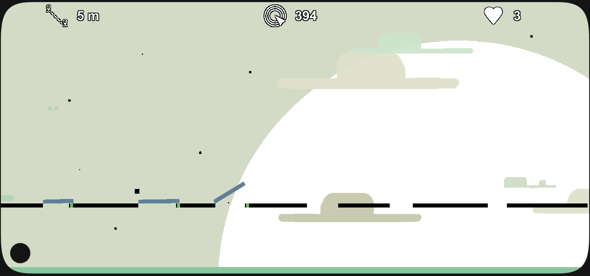

# Rise the Bar

  

<strong>A timing-based arcade platformer about building the bridge to the next island.</strong>

  
  
  

## About

**Rise the Bar** is a 2D side-scrolling score challenge. Hold to grow a bar, release it to bridge the gap, then keep the character moving forward. A bridge that is too short ends the run.

## Highlights

- **Simple precision mechanic:** Estimate the gap and build the right bridge length.
- **Continuous momentum:** The character keeps moving, making every decision immediate.
- **Score chasing:** Better placements and collected stars reward accurate runs.
- **Persistent play:** Audio and local save systems are included.

## Technical details

- **Engine:** Unity 6; the project version is recorded in [ProjectVersion.txt](ProjectSettings/ProjectVersion.txt).
- **Status:** Complete

## Run locally

1. Clone the repository.
2. Open it in Unity Hub with the version recorded in `ProjectSettings/ProjectVersion.txt` (Android Build Support required for mobile builds).
3. Open a scene in `Assets/Scenes` and press Play.

Hold the left mouse button in the editor or hold one finger on Android to grow a bar. Release to drop it. Interrupted touches and app switches cancel an unfinished bar without spending a retry. Perfect placements award 200 points, plus a combo bonus of 50 points per subsequent perfect placement, capped at 250 bonus points per bar. Normal placements and failed bars reset the combo; cancelled input does not. Two consecutive perfect placements still award one retry. Perfect hits show an animated popup and a sound that rises with the combo. Distance measures horizontal progress and freezes when the run ends.

Optional Android haptic feedback can be enabled with the **Vibration** button before starting or after game over. It is off by default and the preference survives replay and app restarts. Device touch-feedback settings also apply.

Perfect-hit feedback appears above the target landing area and follows the camera. Its dark background keeps the text readable, and the entire popup stays inside the screen safe area even when the target platform is offscreen.

## Validation and Android releases

- Run the EditMode and PlayMode suites in **Window > General > Test Runner**.
- Android builds target API 36 and use ARM64 with IL2CPP. Install Android SDK platform 36 through Unity Hub/SDK tools if needed.
- Keep the existing application ID and PlayerPrefs keys when updating the published game so local highscores remain available.
- Configure the release keystore on the build machine; the saved absolute keystore path is machine-specific.
- Before publishing, validate the final AAB's 16 KB page-size support and test an Android device: long runs, retries, rapid/multiple touches, app pause/resume, game over and replay.
